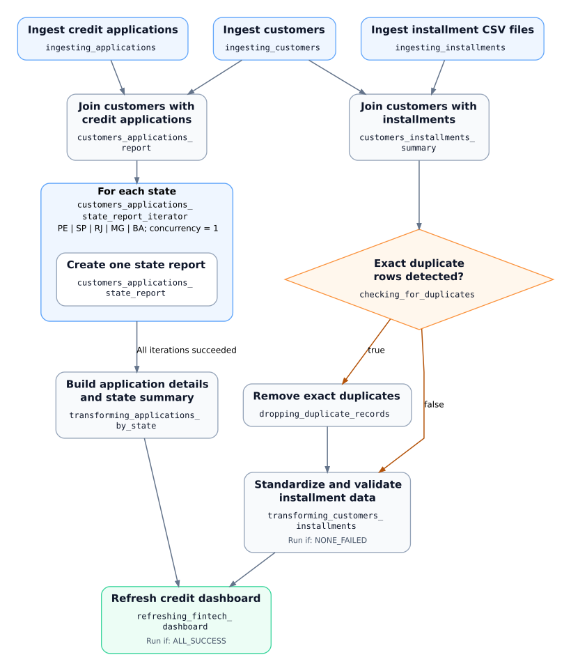

# Fintech Credit Data Pipeline with Databricks Lakeflow Jobs

A data engineering portfolio project for consolidating credit application and installment data into reporting tables. The workflow coordinates ingestion, data quality checks, transformations, failure recovery, and dashboard refresh.

## Project context and objective

The project models a fintech credit operation that needs to answer three questions:

- How much credit are customers requesting, and what are the application statuses?
- How are applications and requested amounts distributed across states?
- How many installments are paid or pending, and what amounts do they represent?

Customer records and credit applications are stored in Delta tables. Installment records are read from CSV files in a Unity Catalog volume. These separate inputs must be combined and standardized before they can support a consistent view of credit operations.

**The objective is to coordinate this processing reliably:** execute tasks after their required inputs are ready, handle exact duplicate records, recover failed processing, and refresh the dashboard after both transformation branches succeed.

The implementation uses synthetic data: five customers, six applications, and six installments.

## Engineering problems and implemented solutions

| Engineering problem | Implemented solution | Evidence |
| --- | --- | --- |
| Applications and installments lack the customer context needed for reporting. | Ingest the three datasets into staging tables, then join applications and installments to customer records using `customer_id`. | [Processing notebooks](01_tasks/README.md) |
| Processing tasks require outputs from different upstream tasks. Running them in the wrong order can produce incomplete results. | Define explicit dependencies in the job DAG. Each join waits for both inputs; the dashboard refresh waits for both final transformations. | [Job configuration](jobs/fintech_credit_recovery_monitoring_job.json) |
| Identical installment rows can inflate record counts and payment totals. | Compare total and distinct row counts, publish a `has_duplicates` task value, and use an If/else task to execute duplicate removal when required. | [Controlled duplicate test](00_setup/01_dynamic_workloads_setup.ipynb) |
| State reports require the same processing logic for different inputs. | Use one parameterized notebook inside a For each task for PE, SP, RJ, MG, and BA. Consolidate the state tables into application details and a state summary. | [State report task](01_tasks/08_applications_by_state.ipynb) and [consolidation task](01_tasks/09_transforming_applications_by_state.ipynb) |
| A failed transformation can interrupt reporting after upstream work has already succeeded. | Diagnose the failed task, correct its source code, and repair the existing job run while preserving successful upstream tasks. | [Failure and repair record](00_setup/02_failure_handling_monitoring_setup.ipynb) |
| Successful execution alone does not prove that reporting data is correct. | Check converted required fields during installment transformation. Use dedicated validation notebooks to verify identifiers, source-to-output consistency, state aggregates, and payment totals. Query system tables to inspect failed and successful task attempts. | [Data validation](02_validation/04_validate_recovery_monitoring_outputs.ipynb) and [execution monitoring](02_validation/05_monitor_fintech_job_runs.ipynb) |

## Workflow architecture

The job has two reporting branches: credit applications and installments. They share customer data and converge at the dashboard refresh.

[Open the full-size workflow diagram](docs/images/lakeflow_job_workflow.svg).

Each node includes its exact task key from the job JSON. The blue For each group contains the nested state-report task; its outgoing dependency waits for all five iterations to succeed.

The [final job template](jobs/fintech_credit_recovery_monitoring_job.json) contains 11 top-level tasks and one nested state-report task. State iterations run sequentially with concurrency set to 1.

Two dependency rules control the branch transitions:

- `NONE_FAILED` allows installment transformation to proceed through either the duplicate-removal path or the path without duplicates.
- `ALL_SUCCESS` requires both final transformations to succeed before the dashboard refresh runs.

The notebook tasks use serverless compute. The saved SQL query and dashboard refresh use a SQL warehouse.

## Reporting outputs

All three final tables are stored under `workspace.fintech_jobs`.

| Output table | Record level | Reporting purpose |
| --- | --- | --- |
| `customers_applications_gold` | One row per application | Customer context, requested amount, application status, calendar fields, and approval indicator |
| `customers_applications_state_summary_gold` | One row per state | Application count, distinct customer count, requested amount, and approved application count |
| `customers_installments_curated` | One row per installment | Typed identifiers, due date, amount due, customer context, and payment status |

Names and status fields are standardized. Installment identifiers, dates, and monetary amounts are converted to the required data types; missing required converted values stop that transformation before its output is written.

## Validation results

The [recovery validation notebook](02_validation/04_validate_recovery_monitoring_outputs.ipynb) compares application records and state aggregates with the expected source-derived results. It also verifies identifier uniqueness and reconciles installment counts and amounts.

| Validation | Recorded result |
| --- | --- |
| Application details | 6 records with 6 distinct application identifiers |
| State summaries | 5 records, matching the expected state aggregates |
| Total requested amount | 35,800.00 |
| Approved applications | 3 |
| Paid installments | 2 records totaling 5,750.00 |
| Pending installments | 4 records totaling 12,350.00 |

The controlled duplicate test also verified both execution paths. With duplicate simulation disabled, six distinct records proceeded directly to transformation. With simulation enabled, seven joined rows contained six distinct records; duplicate removal removed one row and the curated output contained six records.

These checks demonstrate that the reporting tables preserve the expected records and totals for the synthetic dataset.

## Failure recovery and operational monitoring

A controlled failure tested recovery after successful ingestion and state reporting:

1. An application transformation referenced a nonexistent `customer` column and failed with `UNRESOLVED_COLUMN.WITH_SUGGESTION`.
2. The notebook was corrected to reference `customer_name`.
3. The failed transformation was repaired within the same parent job run, preserving successful upstream work.
4. The repaired task produced six application records and five state summaries. The dedicated validation notebook confirmed the output consistency.

The [monitoring notebook](02_validation/05_monitor_fintech_job_runs.ipynb) queries `system.lakeflow.jobs`, `system.lakeflow.job_run_timeline`, and `system.lakeflow.job_task_run_timeline`. Its results distinguish the failed attempt from the successful repair and expose task status and duration.

A subsequent complete run succeeded, including both transformations and the dashboard refresh. The [completion record](00_setup/02_failure_handling_monitoring_setup.ipynb) documents these outcomes.

## Credit operations dashboard

The dashboard makes the processed outputs available as application totals, requested amounts, application statuses, state comparisons, and paid-versus-pending installment totals.

See the [dashboard documentation](03_dashboards/README.md) for the dataset definitions, JSON file, and import instructions.

## Technology choices

| Technology | Role in the project |
| --- | --- |
| SQL and PySpark | Ingestion, joins, data type conversion, standardization, aggregation, and validation |
| Delta Lake and Unity Catalog | Persist staged and reporting tables, organize data assets, and store installment CSV inputs in a volume |
| Lakeflow Jobs | Coordinate dependencies, task parameters, conditional execution, state iteration, and dashboard refresh |
| Serverless compute and SQL warehouse | Execute notebook processing, the saved SQL query, and dashboard queries |
| Lakeflow system tables | Inspect job history, task attempts, statuses, and execution durations |
| Databricks AI/BI dashboard | Present the application and installment reporting outputs |

## Repository guide

| Folder | Purpose |
| --- | --- |
| [`00_setup/`](00_setup/README.md) | Prepare synthetic inputs and document the duplicate-handling and recovery tests |
| [`01_tasks/`](01_tasks/README.md) | Implement ingestion, joins, duplicate handling, state reports, and final transformations |
| [`02_validation/`](02_validation/README.md) | Verify data consistency and inspect workflow execution history |
| [`03_dashboards/`](03_dashboards/README.md) | Provide the dashboard screenshot, dataset definitions, and importable JSON |
| [`jobs/`](jobs/fintech_credit_recovery_monitoring_job.json) | Define the final workflow, task dependencies, parameters, compute, and retry settings |
| [`docs/`](docs/workspace_configuration.md) | Explain workspace paths, resource identifiers, and configuration requirements |

## Reproduce the project

Follow the [workspace configuration guide](docs/workspace_configuration.md) to import the assets, prepare the source data and dashboard, and configure the final job.

The default catalog and schema are `workspace.fintech_jobs`. Replace the job template's workspace path, saved-query identifier, SQL warehouse identifier, and dashboard identifier with values from your own workspace. Configure the monitoring notebook with identifiers from your own job execution history.

Processing uses batch reads and overwrite writes. The results above come from controlled tests on a small synthetic dataset and demonstrate the implemented orchestration, validation, and recovery behavior.
